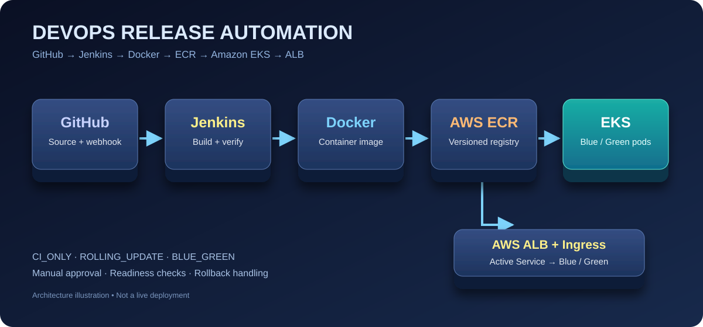
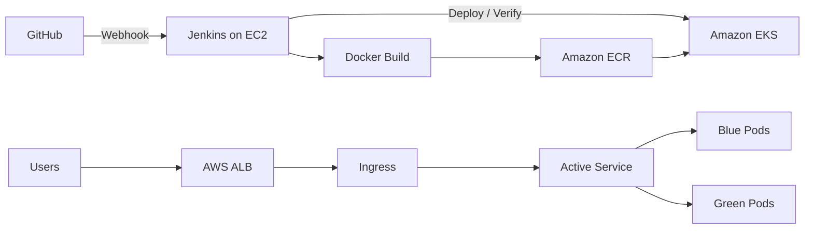

<div align="center">

# DevOps Release Automation on AWS EKS

### Jenkins CI/CD | Docker | Amazon ECR | Kubernetes | AWS ALB | Blue/Green | Rolling Updates

**Production-inspired release engineering portfolio project**

[](https://aws.amazon.com/)


**A hands-on release automation project for a Java JSP web application, with multiple deployment strategies, health verification, and rollback handling.**

[Architecture](docs/architecture.md) · [Setup Guide](docs/setup-guide.md) · [Pipeline](docs/ci-cd-pipeline.md) · [Kubernetes Study Notes](notes/kubernetes/README.md) · [Troubleshooting](docs/troubleshooting.md)

</div>

---

## Project Overview

This repository demonstrates a CI/CD workflow built with GitHub, Jenkins, Docker, Amazon ECR, Amazon EKS, Kubernetes, and AWS Application Load Balancer. It supports **CI-only builds**, **Rolling Updates**, and **Blue/Green deployments with manual approval**. The application runs on Apache Tomcat 10.1 with Java 21.

**Lab status:** The EKS cluster and ALB were deleted after testing to prevent ongoing AWS charges. The documentation describes the completed lab, not a currently live deployment.

## Architecture

<div align="center">
  
</div>



The ALB Ingress points to a stable Kubernetes Service; Jenkins changes that Service's selector when promoting a Blue/Green release. [Read the detailed architecture](docs/architecture.md).

## Repository Structure

```text
devops-release-automation/
├── README.md
├── Dockerfile
├── Jenkinsfile
├── app/
│   └── index.jsp
├── eks/
│   └── eks-cluster.yaml
├── k8s/
│   ├── namespace.yaml
│   ├── deployment-blue.yaml
│   ├── deployment-green.yaml
│   ├── service-blue.yaml
│   ├── service-green.yaml
│   ├── service-active.yaml
│   └── ingress.yaml
└── docs/
    ├── architecture.md
    ├── setup-guide.md
    ├── ci-cd-pipeline.md
    ├── rolling-update.md
    ├── blue-green-deployment.md
    ├── rollback.md
    ├── troubleshooting.md
    └── aws-cleanup.md
└── notes/
    └── kubernetes/
        ├── README.md
        ├── 01-kubernetes-architecture.md
        ├── 02-control-plane.md
        ├── 03-worker-node.md
        ├── 04-pods-and-deployments.md
        ├── 05-services-and-networking.md
        ├── 06-configmaps-and-secrets.md
        ├── 07-storage-pv-pvc.md
        ├── 08-scheduling-and-scaling.md
        ├── 09-security-and-rbac.md
        └── 10-troubleshooting.md
```

## Key Features

| Capability | Implementation |
|---|---|
| CI/CD automation | GitHub webhook and Jenkins declarative pipeline |
| Container build | Docker image built from Tomcat 10.1 / Java 21 |
| Container registry | Amazon ECR, Jenkins build-number image tags |
| Kubernetes | Amazon EKS, Deployments, Services, Ingress |
| Rolling Update | Active Deployment updated with health checks |
| Blue/Green | Two Deployments, manual approval, Service selector switch |
| Release verification | Pod readiness, image match, ALB target health |
| Failure recovery | Strategy-specific rollback attempts in Jenkins |
| Cost control | EKS and ALB cleanup after lab testing |

## Pipeline Modes

| Parameter | Behavior |
|---|---|
| `CI_ONLY` | Build, verify, and push Docker image to ECR |
| `ROLLING_UPDATE` | Update image on the active Kubernetes Deployment |
| `BLUE_GREEN` | Deploy to inactive color, verify, request approval, switch traffic |

The actual [Jenkinsfile](Jenkinsfile) is the source of truth. **This implementation packages the JSP application using the Dockerfile's `jar` command; Maven, Helm, HPA, ConfigMaps, and persistent storage are not currently implemented.**

## Kubernetes Deployment Details

- Namespace: `devops-production`
- Deployments: `java-app-blue`, `java-app-green`
- Services: `java-app-blue-service`, `java-app-green-service`, `java-app-active-service`
- Ingress: `java-app-ingress` using AWS Load Balancer Controller
- Application path: `/java-application/`
- Health probes: readiness and liveness HTTP checks
- Rolling settings: `maxSurge: 1`, `maxUnavailable: 0`

## Local Docker Quick Start

```bash
git clone https://github.com/Pruthviraj7733/devops-release-automation.git
cd devops-release-automation
docker build -t java-application:local .
docker run --rm -p 9090:8080 java-application:local
```

Open `http://localhost:9090/java-application/` while the container is running. Docker is required; no AWS infrastructure is needed for this local demonstration.

## Documentation

| Page | Contents |
|---|---|
| [Architecture](docs/architecture.md) | Infrastructure, application traffic flow, and Mermaid diagram |
| [Setup Guide](docs/setup-guide.md) | Prerequisites, local Docker test, optional AWS deployment |
| [CI/CD Pipeline](docs/ci-cd-pipeline.md) | Jenkins stages, build modes, verification |
| [Rolling Update](docs/rolling-update.md) | Strategy, configuration, validation |
| [Blue/Green Deployment](docs/blue-green-deployment.md) | Approval, promotion, traffic switching |
| [Rollback](docs/rollback.md) | Failure recovery and limitations |
| [Troubleshooting](docs/troubleshooting.md) | Kubernetes, Jenkins, and ALB checks |
| [AWS Cleanup](docs/aws-cleanup.md) | Cost controls and read-only verification commands |

## Kubernetes Learning Notes

Alongside the completed release automation lab, this repository includes a **10-chapter Kubernetes study guide** for theory, command-line practice, architecture revision and DevOps interviews. These notes are educational; their examples are not all implemented or tested in this CI/CD project.

| Learning track | Chapters |
|---|---|
| Architecture and cluster components | [01 Architecture](notes/kubernetes/01-kubernetes-architecture.md) · [02 Control Plane](notes/kubernetes/02-control-plane.md) · [03 Worker Nodes](notes/kubernetes/03-worker-node.md) |
| Workloads and networking | [04 Pods and Deployments](notes/kubernetes/04-pods-and-deployments.md) · [05 Services and Ingress](notes/kubernetes/05-services-and-networking.md) |
| Configuration and persistence | [06 ConfigMaps and Secrets](notes/kubernetes/06-configmaps-and-secrets.md) · [07 PV, PVC and Storage](notes/kubernetes/07-storage-pv-pvc.md) |
| Operations and security | [08 Scheduling and Scaling](notes/kubernetes/08-scheduling-and-scaling.md) · [09 Security and RBAC](notes/kubernetes/09-security-and-rbac.md) · [10 Troubleshooting](notes/kubernetes/10-troubleshooting.md) |

**[Open the complete Kubernetes Notes Index →](notes/kubernetes/README.md)**

## Security and Cost Notes

This is a learning lab. Review hard-coded AWS account IDs, image references, VPC IDs, subnet IDs, and IAM permissions before reuse. Do not commit credentials. Deploying EKS, EC2, or an ALB can incur charges. See the [cleanup guide](docs/aws-cleanup.md).

---

**Maintainer:** [Pruthviraj Markad](https://github.com/Pruthviraj7733) · [LinkedIn](https://www.linkedin.com/in/pruthviraj-markad/)
