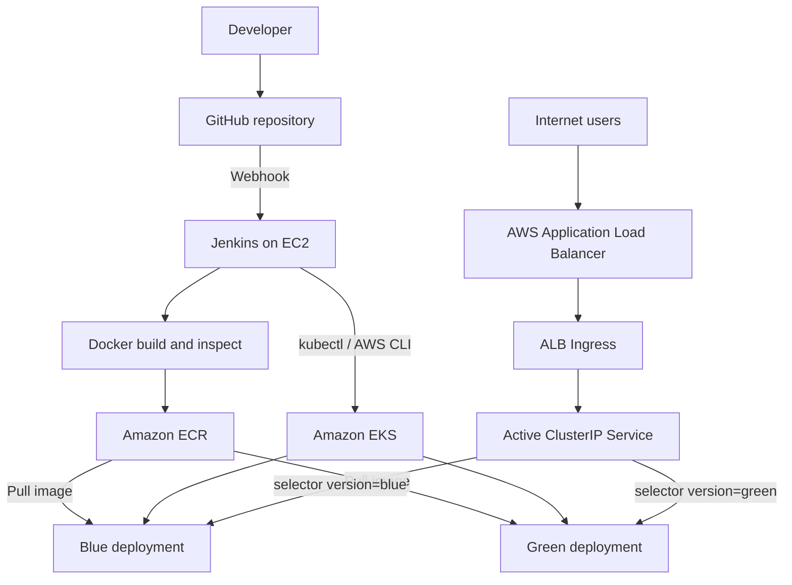

# Architecture

This repository contains a Java JSP web application packaged into a Tomcat container and deployed through Jenkins to Amazon EKS.

## Components
- **Source:** `app/index.jsp`, `Dockerfile`, `Jenkinsfile`, `eks/`, and `k8s/`.
- **Build:** The Dockerfile uses Tomcat 10.1 and Java 21, creates `java-application.war` using `jar`, and exposes container port 8080. The current Jenkinsfile builds the Docker image directly; it does **not** run a Maven stage.
- **Registry:** Amazon ECR `java-application`, with Jenkins build numbers as image tags.
- **Cluster:** `devops-release-cluster` in `ap-south-1`, defined by `eks/eks-cluster.yaml`; managed node group uses two `t3.medium` nodes when created with the supplied configuration.
- **Namespace:** `devops-production`.
- **Workloads:** `java-app-blue` and `java-app-green`, each configured with health probes and resource requests/limits.
- **Routing:** ALB Ingress -> `java-app-active-service` -> Pods labeled `version: blue` or `version: green`. Blue/Green switches the Service selector, not the ALB listener.

> **Lab status:** EKS and ALB were deleted after hands-on testing to avoid ongoing charges. This architecture documents the tested environment, not a currently running endpoint.
