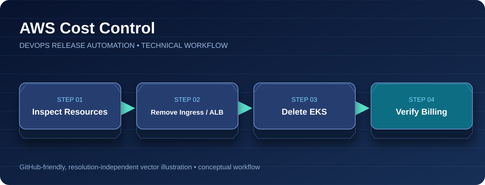

<div align="center">

# AWS Cleanup & Cost Control

**Resource Lifecycle • AWS Operations • Cost Management**



[Project Home](../README.md) · [Architecture](architecture.md) · [CI/CD Pipeline](ci-cd-pipeline.md) · [Blue/Green](blue-green-deployment.md) · [Troubleshooting](troubleshooting.md)

</div>

---


**Original lab status:** EKS cluster `devops-release-cluster` was deleted; both EKS worker instances were terminated; the ALB was absent in the final AWS CLI check. The Jenkins EC2 stop was user-confirmed. Other stopped EC2 instances and attached EBS volumes remain separate resources.

## Order of operations
1. Delete the Kubernetes Ingress **while its AWS Load Balancer Controller and EKS cluster are still running**.
2. Wait until the matching ALB is removed from AWS.
3. Delete the EKS cluster and managed node groups using `eksctl`.
4. Check for leftover CloudFormation stacks, EC2 instances, EBS volumes, NAT Gateways, Elastic IPs, load balancers, and ECR storage.
5. Back up code/configuration before stopping or terminating Jenkins EC2.

## Verification commands (read-only)
```bash
aws eks list-clusters --region ap-south-1 --output table
aws elbv2 describe-load-balancers --region ap-south-1 --output table
aws ec2 describe-instances --region ap-south-1 --query 'Reservations[*].Instances[*].[InstanceId,State.Name,InstanceType]' --output table
aws ec2 describe-volumes --region ap-south-1 --query 'Volumes[*].[VolumeId,State,Size]' --output table
aws ec2 describe-nat-gateways --region ap-south-1 --output table
aws ec2 describe-addresses --region ap-south-1 --output table
aws cloudformation list-stacks --region ap-south-1 --output table
aws ecr describe-repositories --region ap-south-1 --output table
```

## Notes
- Stopped EC2 instances do not incur normal instance compute charges, but attached EBS volumes continue to incur storage charges.
- ECR image storage and other AWS services can incur charges independently.
- Never delete a shared VPC, subnet, unrelated instance, or EBS volume without checking ownership and backups.
- Check AWS Billing/Cost Explorer and all regions for a full account-wide cost review.
