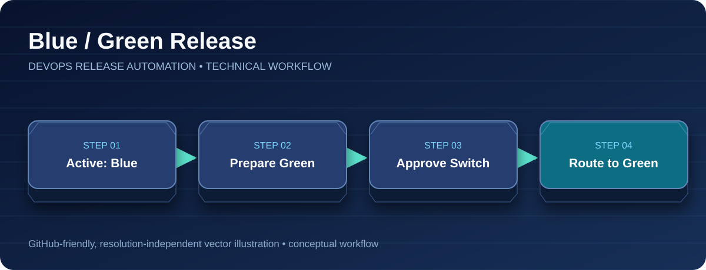

<div align="center">

# Blue/Green Deployment

**Zero-Downtime Release Pattern • Manual Promotion**



[Project Home](../README.md) · [Architecture](architecture.md) · [CI/CD Pipeline](ci-cd-pipeline.md) · [Blue/Green](blue-green-deployment.md) · [Troubleshooting](troubleshooting.md)

</div>

---


The application has two Deployments, `java-app-blue` and `java-app-green`. The stable `java-app-active-service` selects one environment using the Pod label `version`.

## Jenkins release sequence
1. Read the active version (`blue` or `green`) from the Service selector.
2. Choose the opposite environment as the target.
3. Update the target Deployment to the new ECR image and scale it to two replicas.
4. Wait for the target Pods to become Ready and verify two ready replicas.
5. Request manual approval for production promotion.
6. Patch the active Service selector to the target version.
7. Verify active Deployment readiness, image version, and ALB target health.

## Routing
```text
Internet -> ALB -> Ingress -> java-app-active-service
                                  |
                                  +-- version=blue  -> Blue Pods
                                  +-- version=green -> Green Pods
```

The Ingress continues to reference the same Service; Jenkins changes the selector. This is a **Service-selector traffic switch**, not weighted ALB traffic splitting.

## Inspect the live selector
```bash
kubectl -n devops-production get svc java-app-active-service -o jsonpath='{.spec.selector.version}'
kubectl -n devops-production get pods -L version
```

See [Rollback](rollback.md) for reverting traffic. The original EKS cluster and ALB were deleted after testing.
