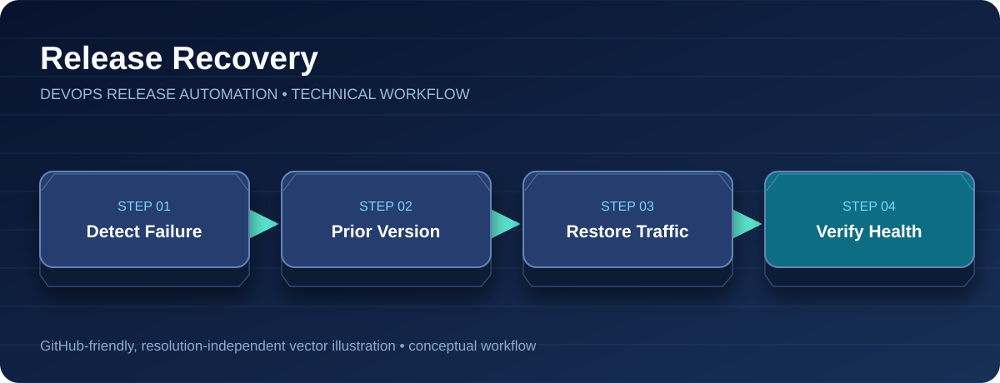

# Rollback & Recovery

**Failure Handling • Traffic Restoration • Validation**

[Project Home](../README.md) · [Architecture](architecture.md) · [CI/CD Pipeline](ci-cd-pipeline.md) · [Blue/Green](blue-green-deployment.md) · [Troubleshooting](troubleshooting.md)

---

The Jenkinsfile contains failure handlers for both deployment strategies.

## Rolling Update
The pipeline records the active Deployment and its previous image before updating. On failure, Jenkins attempts to restore that image and waits for the rollout to complete.

## Blue/Green
Before switching traffic, Jenkins records the active environment. On failure, it attempts to restore the previous color in the stable Service selector.

## Verification
After any recovery, check the active Service selector, Deployment images, Pod readiness, and ALB target health. A rollback attempt can fail; check the Jenkins console for warnings.

An aborted build follows a separate post-build path and is not guaranteed to invoke the failure rollback handler.

## Status
The original EKS cluster and ALB have been removed for cost control. These procedures document the tested release automation and require an active Kubernetes cluster to execute.

See [Blue/Green](blue-green-deployment.md), [Rolling Update](rolling-update.md), and [Troubleshooting](troubleshooting.md).
