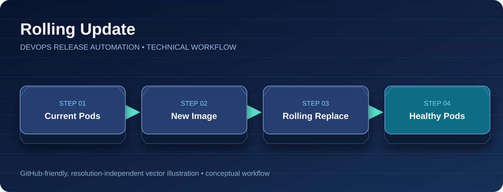

<div align="center">

# Rolling Update

**Controlled Deployment • Readiness • Availability**



[Project Home](../README.md) · [Architecture](architecture.md) · [CI/CD Pipeline](ci-cd-pipeline.md) · [Blue/Green](blue-green-deployment.md) · [Troubleshooting](troubleshooting.md)

</div>

---


The pipeline's `ROLLING_UPDATE` mode identifies the currently active environment from the selector of `java-app-active-service`. It then updates the container image on the corresponding Deployment and waits for rollout completion.

Both deployment manifests configure:
```yaml
strategy:
  type: RollingUpdate
  rollingUpdate:
    maxSurge: 1
    maxUnavailable: 0
```
The Deployments also include readiness and liveness probes at `/java-application/`, `minReadySeconds: 10`, and resource requests/limits.

## Verification commands
```bash
kubectl -n devops-production get svc java-app-active-service -o jsonpath='{.spec.selector.version}'
kubectl -n devops-production get deploy java-app-blue java-app-green
kubectl -n devops-production rollout status deployment/java-app-blue
kubectl -n devops-production get pods -o wide
```

The pipeline records the previous image and attempts to restore it on a failed rolling release. See [Rollback](rollback.md). These commands are examples for a running cluster; the original lab cluster has been deleted.
