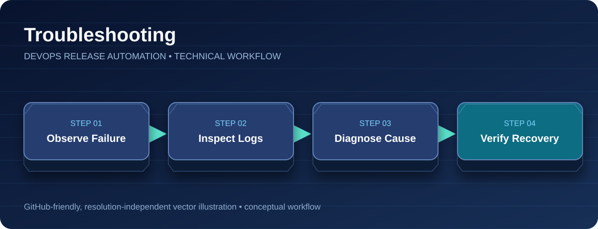

<div align="center">

# Troubleshooting Runbook

**Diagnosis • Logs • Deployment Verification**



[Project Home](../README.md) · [Architecture](architecture.md) · [CI/CD Pipeline](ci-cd-pipeline.md) · [Blue/Green](blue-green-deployment.md) · [Troubleshooting](troubleshooting.md)

</div>

---


Commands below require the relevant AWS resources to exist. The original lab cluster and ALB have been deleted.

## Kubernetes API unreachable
```bash
aws eks list-clusters --region ap-south-1
aws eks update-kubeconfig --region ap-south-1 --name devops-release-cluster
kubectl cluster-info
```
If the cluster no longer exists, `kubectl` may report DNS resolution or API connection errors. Do not recreate the cluster solely for documentation.

## Pod not Ready
```bash
kubectl -n devops-production get pods -o wide
kubectl -n devops-production describe pod <POD_NAME>
kubectl -n devops-production logs <POD_NAME> --tail=100
kubectl -n devops-production get events --sort-by=.lastTimestamp
```
Check image pull permissions, container startup, readiness path `/java-application/`, memory limits, and scheduling capacity.

## ALB has no healthy targets
```bash
kubectl -n devops-production describe ingress java-app-ingress
kubectl -n devops-production get svc java-app-active-service -o yaml
kubectl -n devops-production get pods -L version -o wide
```
Confirm AWS Load Balancer Controller installation, ingress annotations, security groups, healthy Pod endpoints, and HTTP health check path.

## Jenkins deployment fails
Check the Jenkins console log, AWS credentials/IAM, ECR repository, image tag, kubeconfig, `kubectl` rollout status, and rollback warnings. Review the source [Jenkinsfile](../Jenkinsfile) rather than assuming extra build/test stages exist.

## Deployment image verification
```bash
kubectl -n devops-production get deploy java-app-blue -o jsonpath='{.spec.template.spec.containers[0].image}'
kubectl -n devops-production get deploy java-app-green -o jsonpath='{.spec.template.spec.containers[0].image}'
```
