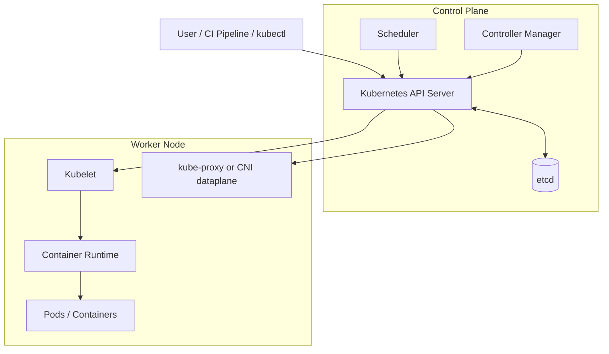

# Chapter 01 — Kubernetes Architecture

**Learning path:** Theory → Architecture → Practical → Practice Tasks → Interview Answer

> These are learning notes. The project's former EKS cluster was deleted to control costs; the commands below require a separate running Kubernetes cluster.

## 1. What is Kubernetes?

Kubernetes (K8s) is an open-source container orchestration platform that automates the deployment, scaling, networking, and lifecycle management of containerized applications. It uses a **declarative desired-state model**: you describe the intended state, and controllers work to reconcile actual state toward it.

## 2. High-level architecture



Kubernetes clusters have **Control Plane** components and **Worker Nodes**. On managed EKS, AWS manages the Kubernetes control plane, while your configured worker nodes run workloads.

## 3. Control Plane Components

| Component | Primary responsibility |
|---|---|
| **kube-apiserver** | Entry point to the Kubernetes API; validates and processes API requests |
| **etcd** | Distributed key-value database storing cluster state |
| **kube-scheduler** | Assigns unscheduled Pods to suitable Nodes based on resource availability and constraints |
| **kube-controller-manager** | Runs reconciliation controllers such as Deployment-related, Node, and Job controllers |
| **cloud-controller-manager** | Optional integration between Kubernetes and cloud-provider APIs |

**Important:** The API server is the central interface. Components observe and update cluster state through it rather than directly manipulating etcd.

## 4. Worker Node Components

| Component | Primary responsibility |
|---|---|
| **kubelet** | Ensures assigned Pods and their containers are running as specified |
| **Container runtime** | Runs containers, commonly containerd |
| **kube-proxy** | Implements Service networking rules in clusters that use it; some CNIs replace this function |
| **CNI plugin** | Provides Pod networking and IP connectivity |

**Pod:** The smallest deployable unit in Kubernetes, containing one or more tightly coupled containers sharing networking and storage context.

## 5. What happens when you create a Deployment?

1. You submit a Deployment YAML using `kubectl apply`.
2. The API server processes and persists the desired configuration.
3. The Deployment controller creates or updates a ReplicaSet.
4. The ReplicaSet controller creates the required Pod objects.
5. The scheduler assigns unscheduled Pods to Nodes.
6. The kubelet on each selected Node instructs the container runtime to start the containers.
7. The CNI sets up Pod networking, and readiness probes determine when Pods can receive Service traffic.
8. Controllers continuously reconcile the actual state with the desired state.

## 6. Hands-on — Read-only Architecture Inspection

Run these commands **only against a running practice cluster**:

```bash
# Check Kubernetes client and server versions
kubectl version

# Inspect control-plane endpoints and cluster services
kubectl cluster-info

# View all Nodes and their roles
kubectl get nodes -o wide

# Inspect detailed Node capacity, conditions, and components
kubectl describe node <NODE_NAME>

# List Pods across namespaces
kubectl get pods -A -o wide

# See Kubernetes system components
kubectl get pods -n kube-system

# Check API discovery and available resources
kubectl api-resources
```

**EKS note:** Managed control-plane Pods are not necessarily visible as ordinary Pods in your account's `kube-system` namespace.

## 7. Practice Tasks

- [ ] Draw Control Plane and Worker Node architecture in your notebook.
- [ ] Explain the difference between `kube-apiserver`, `etcd`, and `kube-scheduler`.
- [ ] Run `kubectl get nodes -o wide` and identify each Node's internal IP, OS, and container runtime.
- [ ] Run `kubectl describe node <NODE_NAME>` and locate **Conditions**, **Capacity**, and **Allocatable**.
- [ ] Explain the complete flow from `kubectl apply` to a Running and Ready Pod.
- [ ] Explain what Kubernetes does when a Pod crashes.

## 8. Interview-level Answer

**Question: Explain Kubernetes architecture.**

"Kubernetes uses a control-plane and worker-node architecture. The control plane manages the cluster's desired state through the API server, etcd, scheduler, and controllers. The API server accepts requests, etcd stores cluster state, the scheduler assigns Pods to suitable Nodes, and controllers continuously reconcile actual and desired state. Worker nodes run application Pods using kubelet and a container runtime, with CNI networking and Service routing provided by kube-proxy or an equivalent dataplane. When I apply a Deployment, Kubernetes creates the required ReplicaSet and Pods, schedules them, starts the containers, and checks readiness. In Amazon EKS, AWS manages the control plane, while the managed worker nodes host our application workloads."

## 9. Quick Revision

**API Server = entry point · etcd = cluster state · Scheduler = placement · Controllers = reconciliation · Kubelet = node agent · Runtime = container execution · CNI = Pod networking.**

[Study Index](README.md) · [Project Architecture](../../docs/architecture.md)
