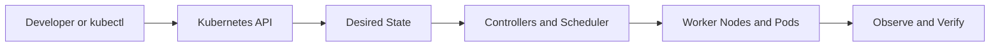

# Chapter 03 — Worker Node Components

**Learning path:** Theory → Architecture → Practical → Practice Tasks → Interview Answer

> Study material, not evidence of deployment in this repository. Run commands only against a disposable practice cluster. The project's EKS cluster and ALB were deleted after testing to prevent charges.

## 1. Theory

A worker runs kubelet, a CRI-compatible container runtime such as containerd, and CNI networking. kube-proxy may implement Service routing, though some CNI dataplanes replace it. Kubelet watches assigned PodSpecs and reports node and Pod status. Node Conditions include Ready, MemoryPressure, DiskPressure and PIDPressure.

## 2. Architecture and request flow



**Apply to this chapter:** Worker Node Components fits into the API-driven desired-state model. Distinguish control-plane operations from the workload resources running on nodes.

## 3. Essential concepts

- **Desired state:** Declarative configuration stored through the Kubernetes API.
- **Actual state:** What is currently running; controllers work to reconcile differences.
- **Namespaces and labels:** Scope resources and identify selected workloads.
- **Operational verification:** Inspect resource status, events, logs and readiness instead of assuming success.
- **Project context:** Review the existing [Jenkinsfile](../../Jenkinsfile) and [Kubernetes manifests](../../k8s/) to distinguish implemented features from study-only topics.

## 4. Hands-on practical

Replace placeholders such as `<NODE_NAME>` with real names. Some commands require metrics-server, an appropriate cluster or permissions.

```bash
kubectl get nodes -o wide
kubectl describe node <NODE_NAME>
kubectl get pods -A -o wide
kubectl top nodes  # requires metrics-server
```

**Safety:** Read commands before execution; creation/deletion examples should be run only in a dedicated practice environment. Cloud resources and storage may incur costs.

## 5. Practice tasks

- [ ] Summarize the theory in your notebook without copying the entire section.
- [ ] Find runtime version, Allocatable CPU/memory, taints and node conditions; explain Pod lifecycle and why a NotReady node affects scheduling.
- [ ] Identify the relevant Kubernetes objects and their relationships.
- [ ] Explain one failure mode and the commands you would use to diagnose it.
- [ ] Describe what is implemented in this project versus what is only studied here.

## 6. Interview preparation

**Q: What is the difference between kubelet and containerd?**

**Sample answer:** Kubelet is the node agent that reconciles assigned Pods; containerd is the runtime that creates and manages containers via CRI. CNI configures Pod networking, and the node reports health back to the control plane.

**Follow-up:** What output would you inspect to verify the behavior in a real cluster?

## 7. Revision checklist

- [ ] Explain the concept in under two minutes.
- [ ] Identify the Kubernetes API objects involved.
- [ ] Recall at least three practical commands.
- [ ] Explain a failure scenario and a verification step.

[Study Index](README.md) · [Project Overview](../../README.md) · [Project Documentation](../../docs/architecture.md)
