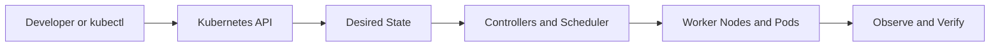

# Chapter 04 — Pods, ReplicaSets and Deployments

**Learning path:** Theory → Architecture → Practical → Practice Tasks → Interview Answer

> Study material, not evidence of deployment in this repository. Run commands only against a disposable practice cluster. The project's EKS cluster and ALB were deleted after testing to prevent charges.

## 1. Theory

A Pod is the smallest schedulable unit. A ReplicaSet maintains a specified number of matching Pods. A Deployment manages ReplicaSets and declarative updates, including rolling deployments and revision history. Labels identify objects; selectors select matching Pods. Readiness controls traffic eligibility, liveness triggers container restart, startup protects slow-starting apps.

## 2. Architecture and request flow



**Apply to this chapter:** Pods, ReplicaSets and Deployments fits into the API-driven desired-state model. Distinguish control-plane operations from the workload resources running on nodes.

## 3. Essential concepts

- **Desired state:** Declarative configuration stored through the Kubernetes API.
- **Actual state:** What is currently running; controllers work to reconcile differences.
- **Namespaces and labels:** Scope resources and identify selected workloads.
- **Operational verification:** Inspect resource status, events, logs and readiness instead of assuming success.
- **Project context:** Review the existing [Jenkinsfile](../../Jenkinsfile) and [Kubernetes manifests](../../k8s/) to distinguish implemented features from study-only topics.

## 4. Hands-on practical

Replace placeholders such as `<NODE_NAME>` with real names. Some commands require metrics-server, an appropriate cluster or permissions.

```bash
kubectl create deployment nginx-study --image=nginx:stable --replicas=2
kubectl get deployments,rs,pods -o wide
kubectl scale deployment/nginx-study --replicas=3
kubectl rollout status deployment/nginx-study
kubectl describe deployment nginx-study
kubectl delete deployment nginx-study
```

**Safety:** Read commands before execution; creation/deletion examples should be run only in a dedicated practice environment. Cloud resources and storage may incur costs.

## 5. Practice tasks

- [ ] Summarize the theory in your notebook without copying the entire section.
- [ ] Create a 2-replica Deployment, scale to 3, inspect ReplicaSet ownership, then delete it. Use a disposable practice namespace.
- [ ] Identify the relevant Kubernetes objects and their relationships.
- [ ] Explain one failure mode and the commands you would use to diagnose it.
- [ ] Describe what is implemented in this project versus what is only studied here.

## 6. Interview preparation

**Q: How does a Deployment differ from a ReplicaSet?**

**Sample answer:** A ReplicaSet maintains a replica count; a Deployment manages ReplicaSets, handles rolling updates and supports revision-based rollback. Pods are ephemeral and should be managed through higher-level controllers for application workloads.

**Follow-up:** What output would you inspect to verify the behavior in a real cluster?

## 7. Revision checklist

- [ ] Explain the concept in under two minutes.
- [ ] Identify the Kubernetes API objects involved.
- [ ] Recall at least three practical commands.
- [ ] Explain a failure scenario and a verification step.

[Study Index](README.md) · [Project Overview](../../README.md) · [Project Documentation](../../docs/architecture.md)
