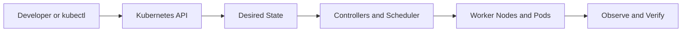

# Chapter 05 — Services, DNS, Networking and Ingress

**Learning path:** Theory → Architecture → Practical → Practice Tasks → Interview Answer

> Study material, not evidence of deployment in this repository. Run commands only against a disposable practice cluster. The project's EKS cluster and ALB were deleted after testing to prevent charges.

## 1. Theory

ClusterIP exposes a stable virtual Service endpoint inside the cluster; NodePort opens a port on nodes; LoadBalancer asks the cloud integration to provision an external load balancer. Service selectors identify eligible Pods; EndpointSlices represent backends. Cluster DNS resolves Service names. Ingress routes HTTP(S) traffic but requires an Ingress controller; in AWS EKS, AWS Load Balancer Controller can provision an ALB. NetworkPolicy enforcement requires a compatible network plugin.

## 2. Architecture and request flow



**Apply to this chapter:** Services, DNS, Networking and Ingress fits into the API-driven desired-state model. Distinguish control-plane operations from the workload resources running on nodes.

## 3. Essential concepts

- **Desired state:** Declarative configuration stored through the Kubernetes API.
- **Actual state:** What is currently running; controllers work to reconcile differences.
- **Namespaces and labels:** Scope resources and identify selected workloads.
- **Operational verification:** Inspect resource status, events, logs and readiness instead of assuming success.
- **Project context:** Review the existing [Jenkinsfile](../../Jenkinsfile) and [Kubernetes manifests](../../k8s/) to distinguish implemented features from study-only topics.

## 4. Hands-on practical

Replace placeholders such as `<NODE_NAME>` with real names. Some commands require metrics-server, an appropriate cluster or permissions.

```bash
kubectl get svc -A
kubectl get endpointslices -A
kubectl get ingress -A
kubectl describe svc <SERVICE_NAME>
kubectl get networkpolicy -A
kubectl get pods -n kube-system
```

**Safety:** Read commands before execution; creation/deletion examples should be run only in a dedicated practice environment. Cloud resources and storage may incur costs.

## 5. Practice tasks

- [ ] Summarize the theory in your notebook without copying the entire section.
- [ ] Sketch browser → ALB → Ingress → active Service → Ready Pod; compare ClusterIP, NodePort and LoadBalancer. Do not provision an ALB just for this task.
- [ ] Identify the relevant Kubernetes objects and their relationships.
- [ ] Explain one failure mode and the commands you would use to diagnose it.
- [ ] Describe what is implemented in this project versus what is only studied here.

## 6. Interview preparation

**Q: How does a Service route traffic to Pods?**

**Sample answer:** A Service provides stable discovery and routing to matching Pod endpoints. DNS resolves its name, EndpointSlices record eligible backends, and the cluster networking dataplane forwards traffic. An Ingress controller adds HTTP(S) routing from outside the cluster.

**Follow-up:** What output would you inspect to verify the behavior in a real cluster?

## 7. Revision checklist

- [ ] Explain the concept in under two minutes.
- [ ] Identify the Kubernetes API objects involved.
- [ ] Recall at least three practical commands.
- [ ] Explain a failure scenario and a verification step.

[Study Index](README.md) · [Project Overview](../../README.md) · [Project Documentation](../../docs/architecture.md)
