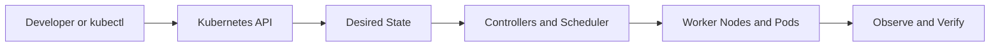

# Chapter 08 — Scheduling, Resources and Autoscaling

**Learning path:** Theory → Architecture → Practical → Practice Tasks → Interview Answer

> Study material, not evidence of deployment in this repository. Run commands only against a disposable practice cluster. The project's EKS cluster and ALB were deleted after testing to prevent charges.

## 1. Theory

Scheduler filters and scores Nodes using requests, taints/tolerations, affinity, topology spread and other constraints. CPU/memory requests affect scheduling; limits bound resource consumption. HPA adjusts replica counts from supported metrics and needs metrics infrastructure; Cluster Autoscaler or Karpenter can adjust node capacity separately. PodDisruptionBudgets constrain voluntary disruptions, not all outages.

## 2. Architecture and request flow



**Apply to this chapter:** Scheduling, Resources and Autoscaling fits into the API-driven desired-state model. Distinguish control-plane operations from the workload resources running on nodes.

## 3. Essential concepts

- **Desired state:** Declarative configuration stored through the Kubernetes API.
- **Actual state:** What is currently running; controllers work to reconcile differences.
- **Namespaces and labels:** Scope resources and identify selected workloads.
- **Operational verification:** Inspect resource status, events, logs and readiness instead of assuming success.
- **Project context:** Review the existing [Jenkinsfile](../../Jenkinsfile) and [Kubernetes manifests](../../k8s/) to distinguish implemented features from study-only topics.

## 4. Hands-on practical

Replace placeholders such as `<NODE_NAME>` with real names. Some commands require metrics-server, an appropriate cluster or permissions.

```bash
kubectl get pods -A -o wide
kubectl describe node <NODE_NAME>
kubectl get hpa -A
kubectl top pods -A  # requires metrics-server
kubectl get pdb -A
```

**Safety:** Read commands before execution; creation/deletion examples should be run only in a dedicated practice environment. Cloud resources and storage may incur costs.

## 5. Practice tasks

- [ ] Summarize the theory in your notebook without copying the entire section.
- [ ] Explain requests versus limits; calculate scheduling for two Pods requesting 500m CPU each; compare HPA and node autoscaling. Do not enable paid cloud resources for practice.
- [ ] Identify the relevant Kubernetes objects and their relationships.
- [ ] Explain one failure mode and the commands you would use to diagnose it.
- [ ] Describe what is implemented in this project versus what is only studied here.

## 6. Interview preparation

**Q: What is the difference between HPA and Cluster Autoscaler?**

**Sample answer:** HPA adjusts application replica counts using metrics; node autoscalers change node capacity when workloads cannot be scheduled or nodes are underused. Neither HPA nor node autoscaling is configured by this project's manifests.

**Follow-up:** What output would you inspect to verify the behavior in a real cluster?

## 7. Revision checklist

- [ ] Explain the concept in under two minutes.
- [ ] Identify the Kubernetes API objects involved.
- [ ] Recall at least three practical commands.
- [ ] Explain a failure scenario and a verification step.

[Study Index](README.md) · [Project Overview](../../README.md) · [Project Documentation](../../docs/architecture.md)
