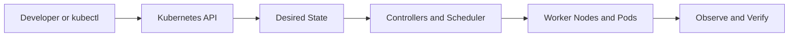

# Chapter 10 — Kubernetes Troubleshooting

**Learning path:** Theory → Architecture → Practical → Practice Tasks → Interview Answer

> Study material, not evidence of deployment in this repository. Run commands only against a disposable practice cluster. The project's EKS cluster and ALB were deleted after testing to prevent charges.

## 1. Theory

Start with symptoms, namespace and recent changes. Check Pod phase, events, container state, readiness/liveness failures, logs and resource pressure. Pending commonly indicates scheduling or volume issues; ImagePullBackOff points to image/auth/network problems; CrashLoopBackOff means a container repeatedly exits; Service failures can come from selectors, EndpointSlices, DNS or networking. For EKS/ALB, inspect controller events and target health.

## 2. Architecture and request flow



**Apply to this chapter:** Kubernetes Troubleshooting fits into the API-driven desired-state model. Distinguish control-plane operations from the workload resources running on nodes.

## 3. Essential concepts

- **Desired state:** Declarative configuration stored through the Kubernetes API.
- **Actual state:** What is currently running; controllers work to reconcile differences.
- **Namespaces and labels:** Scope resources and identify selected workloads.
- **Operational verification:** Inspect resource status, events, logs and readiness instead of assuming success.
- **Project context:** Review the existing [Jenkinsfile](../../Jenkinsfile) and [Kubernetes manifests](../../k8s/) to distinguish implemented features from study-only topics.

## 4. Hands-on practical

Replace placeholders such as `<NODE_NAME>` with real names. Some commands require metrics-server, an appropriate cluster or permissions.

```bash
kubectl get pods -A -o wide
kubectl describe pod <POD_NAME> -n <NAMESPACE>
kubectl logs <POD_NAME> -n <NAMESPACE> --previous
kubectl get events -n <NAMESPACE> --sort-by=.metadata.creationTimestamp
kubectl get svc,endpointslices,ingress -n <NAMESPACE>
kubectl rollout status deployment/<DEPLOYMENT> -n <NAMESPACE>
```

**Safety:** Read commands before execution; creation/deletion examples should be run only in a dedicated practice environment. Cloud resources and storage may incur costs.

## 5. Practice tasks

- [ ] Summarize the theory in your notebook without copying the entire section.
- [ ] Diagnose a hypothetical Pending Pod, CrashLoopBackOff and a Service with no endpoints. Identify a safe rollback option and verify recovery.
- [ ] Identify the relevant Kubernetes objects and their relationships.
- [ ] Explain one failure mode and the commands you would use to diagnose it.
- [ ] Describe what is implemented in this project versus what is only studied here.

## 6. Interview preparation

**Q: How do you troubleshoot a failed Kubernetes deployment?**

**Sample answer:** I inspect Deployment and Pod status, describe failing Pods, read current and previous logs, check events, resource requests, image pull access, probes and Service endpoints. I validate ingress/controller health and compare the last change; then I restore a known-good version and confirm application readiness and traffic.

**Follow-up:** What output would you inspect to verify the behavior in a real cluster?

## 7. Revision checklist

- [ ] Explain the concept in under two minutes.
- [ ] Identify the Kubernetes API objects involved.
- [ ] Recall at least three practical commands.
- [ ] Explain a failure scenario and a verification step.

[Study Index](README.md) · [Project Overview](../../README.md) · [Project Documentation](../../docs/architecture.md)
